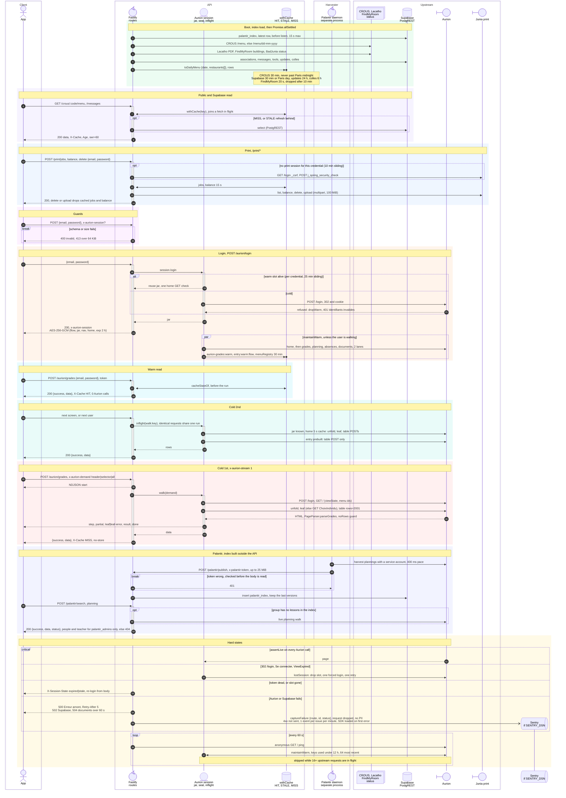

# Mauria API

A Fastify gateway between the [Mauria app](https://github.com/MauriaApp/Webapp) and [Junia](https://www.junia.com) services: [Aurion](https://aurion.junia.com) grades, planning, absences and documents, [CROUS](https://croustillant.menu) and [Lacatho](https://all-lacatho.fr/fr/menu-jour) menus, [FindMyRoom](https://findmyroom.junia.com), [Junia print](https://print.junia.com/end-user/ui), [Supabase](https://supabase.com) content and Palantir search. Inputs are checked against JSON schemas, with no type coercion. Each user's reads stay warm in memory, so a repeat planning read drops from 5 s to 3 ms. Slow first reads stream step by step. Server errors go to [Sentry](https://sentry.io) without user info, cookies, headers or request bodies, and secrets are scrubbed before sending. It runs on one 256 MB machine on Fly.io.

<table>
<tr><td>

https://github.com/user-attachments/assets/dc9d5532-8830-4522-abeb-e613817bd70d

</td></tr>
</table>

Each coloured band is one flow. On GitHub, use the diagram's pan and zoom controls to read the details.

| Step | Command | Notes |
| --- | --- | --- |
| Configure | <pre lang="sh">cp .env.example .env</pre> | fill `SUPABASE_URL`, `SUPABASE_KEY`, `SUPABASE_SERVICE_KEY` (see [`.env.example`](.env.example); `.env.dev` for `dev`) |
| Install | <pre lang="sh">npm ci</pre> | Node 26 in `.nvmrc` (22.13+ supported) |
| Develop | <pre lang="sh">npm run dev</pre> | reloads on save, needs [Bun](https://bun.sh), reads `.env.dev` |
| Typecheck | <pre lang="sh">npm run typecheck</pre> | |
| Build & test | <pre lang="sh">npm test</pre> | builds `dist/` and runs all 753 tests |
| Serve | <pre lang="sh">npm start</pre> | port 8080, docs at `/docs`, 160 MiB heap |
| Container | <pre lang="sh">docker build --platform linux/amd64 -t mauria-api .&#10;docker run --env-file .env -p 8080:8080 mauria-api</pre> | same 193 MB image as Fly |
| Harvester | <pre lang="sh">node dist/palantir-daemon.js</pre> | systemd unit in [`scripts/palantir-harvest.service`](scripts/palantir-harvest.service) |
| Deploy | <pre lang="sh">fly secrets set SUPABASE_URL=... SUPABASE_KEY=... SUPABASE_SERVICE_KEY=... --stage&#10;fly deploy --remote-only</pre> | CI deploys every push to `main` with the tested image |
