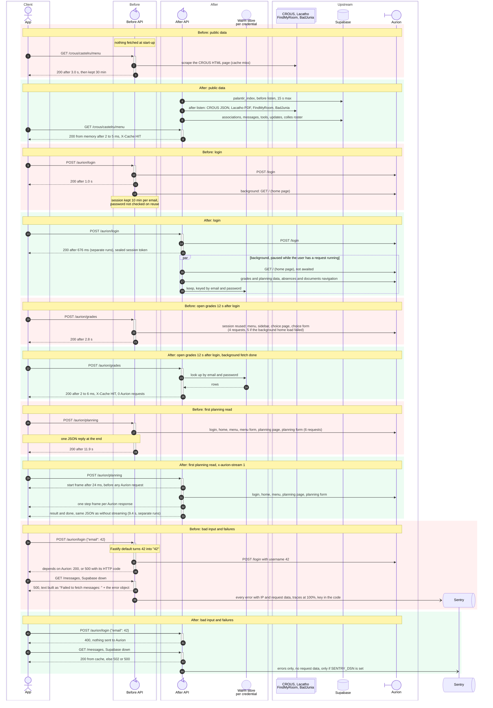

# Changelog

## At a glance

| What | Before | After | Measured |
|---|---|---|---|
| Re-open 4 screens | 18 Aurion requests | 1 request | lab |
| Open planning again | 5.0 s | 3 ms | live |
| First sign of life while planning loads | 11.9 s (one reply at the end) | 24 ms (streaming) | live |
| Open planning, first time | 11.9 s | 9.4 s | live, separate runs |
| Log in | 1.0 s | 676 ms | live, separate runs |
| CROUS menus, first call | 3.0 s | 2 to 5 ms | live |
| Lacatho menu | error `500` | works, 8.5 ms | live |
| Documents | error `500` | partial list in 6 s | live |
| Known vulnerabilities (`npm audit`) | 48 advisories in 24 packages, 30 high | 0 | count |
| Student data sent to Sentry | every first read | none | lab |
| Packages in the lockfile | 284 | 153 (103 runtime, 6 of them per-platform PDF binaries) | count |
| Docker image | Node 20, 568 MB | Node 26, 192 MB (139.0 MB unpacked `fileBytes`, 4 layers, 1.63 MB bundle / 249 KiB gzip) | count |
| Memory at idle (process RSS and V8 heap) | 109 MB RSS | 99 MB container RSS, 21 MiB `heapUsed` in 176 MiB old space and 2 MiB semi-space | lab |
| Planning, returning student (16 at once) | 37 req/s, 4.2 to 4.9 ms CPU per request | 2,130 to 2,302 req/s, 0.38 to 0.42 ms CPU | lab |
| Planning, student never seen before (64 at once) | 96 to 98 req/s, p95 673 to 675 ms, peak 289 to 291 MB, 6.0 to 7.3 ms CPU | 115 to 116 req/s, p95 581 to 603 ms, peak 128 to 152 MB, 3.9 to 5.5 ms CPU per request | lab |
| Fly machine | 512 MB, 2 shared CPUs, stopped when idle | 256 MB, 1 shared CPU: about half the price per running hour ($0.0030 vs $0.0061, Fly list price in `iad`), one machine stays on | count |
| Automated tests | 0 | 763, all pass on Linux with Docker (762 without Docker, 761 in CI mode), 100% V8 L/B/F coverage | test |

## Architecture

## Speed

| What | Before | After | Measured |
|---|---|---|---|
| Log in | 1.0 s | 676 ms | live, separate runs |
| Open planning, first time | 11.9 s | 9.4 s | live, separate runs |
| Open grades, first time | 10.2 s | 7.9 s | live, separate runs |
| First sign of life, planning | 9.4 s | 24 ms | live |
| First sign of life, documents | 10.6 s | 26 ms | live |
| Open planning again | 5.0 s | 3 ms | live |
| Open grades 12 s after login | 2.8 s | 2 to 6 ms | live |
| Open documents 15 s after login | error `500` (1.3 s without pre-open) | 5 ms | live |
| Open documents, first time | error `500` | partial list in 6 s | live |
| CROUS menus, first call | 3.0 s | 2 to 5 ms | live |
| FindMyRoom buildings | 1.7 s | 2.4 ms | live |
| Lacatho menu | error `500` | 8.5 ms | live |
| Documents, first time, two requests sent together | 973 ms | 642 ms | lab |
| Documents detail body build & fetch | 2.5 s (rebuilt per row) | 1.9 s (pre-built `detailPlan.body`, 3.4x to 13.2x faster) | lab |
| Sealed session resume on cold cache (tables / planning) | 8 calls / 10 calls | 4 calls (-50%) / 6 calls (-40%), 1 unfold POST | lab |
| Median wait with 256 users at once | 2.4 s | 1.6 s | lab |
| Planning, first time, two requests sent together | 10.6 s, 6 steps | 7.0 s, 4 steps | lab |
| Supabase `/tools`, first call | 24.7 ms | 1.5 ms (client loaded at start-up) | lab |
| Start-up to ready, no Sentry key | 524 ms | 387 ms | lab |
| API description, 8 users at once | 1,430 per s | 5,996 per s | lab |
| Read a 20,000-row Aurion table | 237 ms | 0.085 ms | lab |
| Start-up to ready, validators compiled on first request | 356 ms | 275 ms | lab |
| Grades page parse, per read | 788 µs, 1,073 KB | 637 µs, 413 KB | lab |
| 20 Aurion HTML/XML parsers | baseline | 1.52x faster (`parseAgenda` 1.98x, hidden inputs 2.03x) | lab |
| Hostile nested-table input to the parser | 1,224 ms | 1.4 ms | lab |
| Palantir: one teacher's lessons, group lookup, group lessons & people search | 29.3 ms lessons; 318 µs group; 3.15 µs group lessons; 7.41 ms people | 3 µs lessons; 9.6 µs group (33x faster); 1.15 µs group lessons (2.7x); 0.48 ms people (15.4x faster) | lab |
| CROUS date memo, `/json` ETag, gzip header & flight key | `Intl` per call; 64.3 ns ETag; regex gzip | 30x date memo; 14.6 ns ETag (4.4x); 22x to 42x gzip; 12x to 14x flight key | lab |
| Sentry scrubber, Paris offset, Print parser & login code check | baseline | 2.91x scrubber, 1,509x `parisOffset`, 1.93x Print parser, 17x `loginCode` check | lab |
| Menu PDF, 8 MiB download | 77.6 ms | 52.3 ms (single-allocation `Buffer.allocUnsafeSlow`, 0 double-copy) | lab |

## Load on Aurion and other sources

| What | Before | After | Measured |
|---|---|---|---|
| Re-open 4 screens | 18 requests | 1 | lab |
| Open 4 screens, first time | 26 requests | 22 | lab |
| Open documents, first time | 8 requests | 5 | lab |
| Documents with 6 menu entries | 20 requests, stops after page 1 | 15 requests, all 6 pages | test |
| Supabase read, repeated | 1 request each time | 0 until the cache expires | lab |
| Many users miss the cache at once | 1 request per user | 1 request in total | count |
| Hand-edited Supabase data, requests per week | baseline | -75%, -43%, -92%, -96% (4 tables) | count |
| Lacatho, menu still current | old menu served up to 12.4 h | checked each day; a menu dated today is rechecked (one page request) every 3 h at most | test |
| Users come back after a deploy (16 users) | 16 logins, 96 requests | 0 logins, 48 requests | test |
| User returns after 40 min idle | 1 new login | 0 | lab |
| 8 wrong passwords in a row | 8 Aurion requests | 3 | test |
| Palantir harvest restart loop | 32 logins, 33 requests | 1 login, 10 requests | test |
| Requests at start-up | 1 (`palantir_index`) | 13 (5 services) | test |
| Background requests after a login | 2 | 13 | test |
| Keep-alive ping to Aurion | none | 1 per minute (1,440 a day) | count |
| Warm screens re-read, work per request | 1,120 KB (grades) | 391 KB (-65%; -82% on planning) | lab |
| Keeper cycle, 810 active users | 2,127 upstream requests | 51 | lab |
| Accounts kept warm upstream | no bound | 64 most-recently-active, LRU (`AURION_KEEPER_MAX`) | count |
| Keeper pass during a burst | runs even at peak load | skipped while 16+ upstream requests are in flight (`AURION_KEEPER_SKIP_HOT`) | count |
| Documents detail fan-out | unbounded parallel upstream calls | batched by the socket-pool width (32 at a time on Fly, 8 by default) | count |
| Aurion socket pool width | fixed at 8 | `AURION_MAX_SOCKETS`, 8 by default, 32 on Fly | count |
| Menu PDF refetched, same bytes | parsed again every time | parsed once (sha256 memo) | lab |
| Warm fill rate & cold student load (6,023-student cgroup run) | 6.59 calls/warm req; 31.9 calls/cold student | 0.01 calls/warm req; 21.9 calls/cold student | lab |
| `/palantir/people` colles roster read | 1 Supabase read per search | 1 read per 6 h (`rosterRows` cache) | test |
| Palantir publish on permanent `4xx` (`401`/`403`) | 6 attempts (2.5 h of sleeps) | 1 attempt (fails fast; retries `408`, `429`, `5xx`) | test |

## Caching

| What | Before | After | Measured |
|---|---|---|---|
| Supabase reads | no cache | cache, served stale if Supabase fails | test |
| Cache entry expires | the next user waits for the refresh | old copy served while one refresh runs; failed refreshes back off | test |
| Public data at start-up | fetched on first request | fetched right after start-up | test |
| CROUS menu kept | 30 min | 30 min, never past midnight in Paris; today's menu is refetched at expiry, only a later published day stays | test |
| CROUS venue (`/crous/:code`) | not cached (new route) | 30 min | count |
| Hand-edited data kept | read on every request | `/updates` 24 h; messages, tools, associations until Paris midnight; colles 6 h | count |
| Cache size (entry bounds, not RSS) | no size cap | 48 MiB and 32,768 entries; a 100,000-key flood peaks at 151 MB RSS instead of an OOM at 23,010 keys | test, lab |
| 32,768-entry `MAX_ENTRY_AGE_MS` sweep | $O(N)$ scan (20.8 s ceiling, 40.5 s across 3 suites) | $O(1)$ ordered `else break`: 547 ms ceiling, 953 ms total (42.5x faster) | test |
| Sealed cache, 5,000 keys sharing one identical payload | 625 MB (one buffer per key) | 55 KiB (one shared slot, -99.99% RAM, 48x warm write); each key still holds its own entry, so this is not the RSS for 5,000 students | lab, test |
| Warm session state, one account | not measured | ~20 KiB per account; 2,000-slot cap, 25 min sliding TTL | lab, test |
| Oldest entry served | no limit | 24 h | count |
| One client floods the cache with new keys | evicts everyone's entries | evicts only its own family | test |
| Aurion pages already visited | fetched again each time | reused per credential for 25 min sliding | test |
| Aurion session idle 10 to 25 min, not kept by the keeper | a new login (about 5.5 s cold) | the session is reused; live probe: logged-in session alive at 10, 15, 20, 25 and 30 min idle, dead at 35 | lab |
| Data after login | fetched when asked | fetched in the background right after login | test |
| Documents list, warm | 12 requests, no cache | 0 | test |
| Expired-session empty page | cached as "no grades" for 30 min | never cached | test |
| Partial documents, old FindMyRoom data | cached and served | not cached; FindMyRoom dropped after 10 min | test |
| Same request twice at once | ran twice, or shared by user only | one run, shared only when identical | test |
| Lacatho new day | no change detection | page head and date checked, 2 h ceiling | test |

## Reliability and errors

| What | Before | After | Measured |
|---|---|---|---|
| Aurion session expired | `500`, or an empty list | detected (redirect to login, "Se connecter", "ViewExpired"), one fresh login, one retry | test |
| Expired session read as "reduced menu" | retries refused for 10 min | retried | test |
| App's saved session too old | not handled | normal answer + `X-Session-State: expired` | test |
| Wrong password at login | `500` | `401 Identifiants invalides` | test |
| Print login refused | `500` | `401` | test |
| Print session ended by the print site | new login on every call | session kept 10 min; a redirect to the print login drops it, logs in once more and retries (an upload already sent is not resent) | test |
| Many fresh users at once (keeper burst) | process killed at the 160 MiB V8 heap limit | survives, 200 MiB peak (64-account LRU bound) | lab |
| More students than one machine serves (~8) | everyone queues inside the machine, p95 370 ms and p99 450 ms at 64 | past 25 concurrent requests the Fly proxy holds new ones in its queue (`503` only under long overload); the machine keeps serving the first 25 (Fly soft 20 / hard 25) | lab, Fly docs |
| Outage error text | upstream message in the body (hosts, ports, page errors) | fixed `Erreur amont`; the detail goes to Sentry; messages the API writes itself still shown | test |
| Supabase down | `500`, text built as "Failed to fetch messages: " + the error object | `500` or `502` + "retry in 5 s" | test |
| FindMyRoom error | `500`, leaks the upstream HTML | `502 Erreur amont`, nothing echoed | test |
| FindMyRoom 404 | `500` "database error" | `404` | test |
| Old CROUS menu missing | `500` | `404` | test |
| `/updates?head=1` on an empty table | `500` | `200` | test |
| Supabase status codes | one flat status | upstream status kept | test |
| Supabase column renamed | `500` | `200`; retried with `select=*`, order kept then dropped | test |
| Supabase hangs | 1 min 7 s | `502` after about 15 s | test |
| Lacatho PDF unreadable | "database error" | "Reponse amont illisible" | test |
| Documents after an Aurion `500` | `200` with an empty list | named error | test |
| Documents while Aurion is slow | waits, then fails | rows read so far + `partial: "budget"`; `504` past 1 min | test |
| One documents step fails | `500` | rows read so far + `partial: "leaves"` | test |
| BadJunia status when it cannot check | "all fine" | `null` fields + `X-BadJunia-Verified: false` | test |
| Hung upstream | waits forever | Aurion 12 s per call and 25 s per flow, Supabase 15 s, 30 s per request, 2 retries for reads | count |
| A 33 s flow | socket dropped | named `500` at 25 s | test |
| Aurion refuses a sidebar step | rows returned anyway | named error | test |
| Planning sidebar unreadable | silent 0 | named error | test |
| Grades table over 2,000 rows | 2,000 rows, no warning | named error | test |
| Retry of a failed request | reused the failed result | new run; retries only network, `5xx` and lost sessions | test |
| Download over 16 MiB | buffered, wiped every download link | refused before buffering | test |
| Health check | none | `GET /healthz`, checked by Fly | count |
| Deploy restart | drops requests in progress | finishes them first | count |
| Harvest daemon start | crash | starts | test |
| Harvest after a refused roster view | every roster lost | rosters kept | lab |

## Correct data

| What | Before | After | Measured |
|---|---|---|---|
| Amount "3,50 EUR" | read 100 times too large | 3.5 | test |
| Planning week numbers | local weeks | ISO weeks | test |
| Changelog versions sorted | as text | as numbers (`x.y.z`) | test |
| Lacatho file picked | guessed | checked by file signature and date | test |
| Lacatho allergen table | shown as "Sandwicherie" | right section | test |
| Lacatho dish names | 5 of 5 wrong | 0 wrong | test |
| Documents labels | 6 of 17 wrong | 0 | test |
| Agenda, two readers | 11 differences in 1,497 pages | 0 | test |
| Paris time offset (supa-data) | exact at 0 of 516,984 instants | exact at all | test |
| Absences menu entry | 8 wrong entries read on the real host | right entry | test |
| Documents submenu | fixed id that drifted | found by its label | test |
| Menu label with accents or entities | not matched | matched | test |
| Associations image | fallback picked first | stored image first | test |
| Instagram handle | `.../bde_junia/.jpg` | `.../bde_junia.jpg` | test |
| Important messages | one object | list ordered by id | test |
| Palantir retry result, nested Aurion error | dropped, blank | kept, name and message read | test |
| Custom planning window DST offset, hyphenated `collesGroup` (`MPI-K1`), merged/tall Lacatho sections | server-now offset; `null` group; unmerged/dropped rows | window-start offset (`parisOffset(start)`); matched group; merged sections & kept rows | test |

## Security and privacy

| What | Before | After | Measured |
|---|---|---|---|
| Certificate checks to Aurion | off at 2 places | on | count |
| Sentry key | written in the code | read from settings; Sentry off without it | count |
| Personal data to Sentry | `sendDefaultPii: true`, every request traced | off, errors only | count |
| Headers, cookies, tokens in Sentry events | sent | request blocks removed at any depth; secret-named keys masked | test |
| The request's own email and password in Sentry events | passed when an upstream echoed them in a message, cause or stack | redacted by value everywhere in the event; upstream HTML and long bodies masked whole | test |
| Malformed input | types coerced (Ajv default) | rejected, `400` | test |
| Bad request shapes accepted | 86 | 0 (208 paths answer `400`) | test |
| Huge body | accepted | `413` over 64 KiB, declared on 15 routes | test |
| Wrong password after a good login | accepted for 10 min | refused | test |
| Session keys of two accounts | 1,967,722 collisions in 2,002,220 pairs | 0 | test |
| Session survives a deploy | no | yes, sealed token (AES-256-GCM) bound to the login | test |
| Session and publish secrets | set by hand | derived from `SUPABASE_SERVICE_KEY` | count |
| Download link | holds the login, reusable | one-time random 256-bit link | test |
| Download file name | header injection possible | cleaned and escaped | test |
| Download link in caches | cacheable | `no-store` | test |
| Print upload | 100 MiB held in memory | 100 MiB streamed, first 2 KiB PDF header sliced once | test |
| Palantir publish, anonymous 24.8 MiB body | parsed before the token check, 216 ms of CPU | token first, 12 ms | test |
| `.env` in the Docker build | included | excluded: the build context is an allowlist (`src/`, `scripts/lock.mjs`, `scripts/stubs/`, package files, `tsconfig.json`) | test |
| Known vulnerabilities (`npm audit`) | 48 (2 low, 16 moderate, 30 high) | 0 | count |
| `@sentry/node` | 10.16.0 | 11.8.0 | count |
| Swagger UI, `@fastify/static` | open advisories | patched | count |
| CodeQL (`v2.27.3`) | 1 workflow alert, 17 JS/TS alerts | 0 workflow alerts; 8 fixed in code, 9 false-positive/test alerts triaged | count |

## Scope

| Risk to students | Level | Why it stays |
|---|---|---|
| One password opens grades, absences and documents; no second factor seen at login | critical | Aurion's design; a leaked or reused password works everywhere |
| Aurion itself (version, patches, session handling) | unknown, up to critical | not reviewed; no public advisory found |
| The app sends the password with every request, so the API can log in again | high | needed by the design; protected by TLS, never stored by the API |
| Aurion brute-force limits | medium | logins get refused after repeated tries, the threshold is unknown |
| Print portal, FindMyRoom, Supabase access rules | unknown | not reviewed |

## Attack vectors closed in the API

| Vector | What a student risks | Before | Fix |
|---|---|---|---|
| [Session reused by email](https://cwe.mitre.org/data/definitions/287.html) | anyone who knows their email reads their data for 10 min, any password | **open** | session bound to the password |
| [No certificate check](https://cwe.mitre.org/data/definitions/295.html) | password and cookies read on the network path | **open** (Aurion, print) | checks on |
| [Personal data to Sentry](https://github.com/advisories/GHSA-6465-jgvq-jhgp) | IP, request data, auth headers at a third party (CVE-2025-65944) | **open** | errors only, no personal data |
| [Download link](https://cwe.mitre.org/data/definitions/598.html) | anyone who sees the URL within 2 min gets the file; credentials inside, encrypted | **open** | random one-time link |
| [Type coercion](https://fastify.dev/docs/latest/Reference/Validation-and-Serialization/) | malformed input reaches Aurion | **open** | strict `400` |
| [Error text echoed](https://cwe.mitre.org/data/definitions/209.html) | internal details shown | **open** (every route returns the raw message) | fixed texts, detail only in Sentry |
| [Anonymous 25 MiB publish](https://github.com/fastify/fastify-auth) | service down for everyone | **open** | token before body |
| [Upload in memory](https://github.com/fastify/fastify-multipart) | service down for everyone | **open** | streamed |
| [Sentry key in code](https://docs.sentry.io/concepts/key-terms/dsn-explainer/) | fake error reports | moved to settings; old public key valid until rotated | from settings |
| [Raw file name in header](https://cwe.mitre.org/data/definitions/113.html) | failed download | partly | cleaned |
| [`.env` in Docker build](https://trufflesecurity.com/blog/how-secrets-leak-out-of-docker-images) | server keys in the build cache | low | excluded |

## Known vulnerabilities (CVE)
| | Before | After |
|---|---|---|
| Advisories | 48 | 0 |
| High | 30 | 0 |
| Moderate | 16 | 0 |
| Low | 2 | 0 |
| Packages affected | 24 | 0 |

| Package | Advisories | CVE | Before | After |
|---|---|---|---|---|
| `fastify` | 6 high, 3 moderate, 1 low | CVE-2026-84469, CVE-2026-84504, CVE-2026-76169, CVE-2026-25223, CVE-2026-84428, CVE-2026-33806, CVE-2026-92081, CVE-2026-3635, CVE-2026-18504, CVE-2026-25224 | 5.6.0 | 5.12.7 |
| `fast-uri` | 8 high, 1 moderate | CVE-2026-84292, CVE-2026-75975, CVE-2026-6321, CVE-2026-6322, CVE-2026-16221, CVE-2026-13676, CVE-2026-18446, CVE-2026-76172, CVE-2026-86472 | 3.1.0 | 4.2.1 (3.1.8 in ajv) |
| `brace-expansion` | 5 high, 2 moderate | CVE-2026-14257, CVE-2026-102276, CVE-2026-13149, CVE-2026-69152, CVE-2026-102278, CVE-2026-102277, CVE-2026-33750 | 1.1.12, 2.0.2 | 5.0.12 |
| `@fastify/static` | 1 high, 3 moderate | CVE-2026-15074, CVE-2026-7120, CVE-2026-6414, CVE-2026-6410 | 8.2.0 | 10.1.6 |
| `minimatch` | 3 high | CVE-2026-27903, CVE-2026-27904, CVE-2026-26996 | 10.0.3, 3.1.2 | 10.2.6 |
| `picomatch` | 1 high, 1 moderate | CVE-2026-33671, CVE-2026-33672 | 2.3.1 | removed |
| `ws` | 1 high, 1 moderate | CVE-2026-48779, CVE-2026-45736 | 8.18.3 | removed |
| `@isaacs/brace-expansion` | 1 high | CVE-2026-25547 | 5.0.0 | removed |
| `braces` | 1 high | CVE-2026-93687 | 3.0.3 | removed |
| `find-my-way` | 1 high | CVE-2026-47219 | 9.3.0 | 9.9.0 |
| `glob` | 1 high | CVE-2025-64756 | 11.0.3 | 13.0.6 |
| `http-cache-semantics` | 1 high | CVE-2026-93748 | 4.2.0 | removed |
| `@opentelemetry/core` | 1 moderate | CVE-2026-54285 | 2.1.0 | removed |
| `@opentelemetry/instrumentation-knex`, `-mongoose`, `-mysql`, `-mysql2`, `-pg`, `-tedious` | 1 moderate, shared | CVE-2026-104872 | 0.49.0 and others | removed |
| `@sentry/node` | 1 moderate | CVE-2025-65944 | 10.16.0 | 11.8.0 |
| `ajv` | 1 moderate | CVE-2025-69873 | 8.17.1 | 8.20.0 |
| `yaml` | 1 moderate | CVE-2026-33532 | 2.8.1 | 2.9.1 |
| `diff` | 1 low | CVE-2026-24001 | 4.0.2 | removed |
## Remaining risks in the API

| Risk | Status | Next step |
|---|---|---|
| Dependency advisories | 0 known today | re-run `npm audit` before each deploy |
| Earlier Sentry key in public git history | still valid until rotated | rotate the key in Sentry |
| A credential in a Sentry event that is not the request's own and sits under a neutral key | passes the scrubber (the request's own email and password are redacted by value) | none planned; upstream bodies are already masked whole |
| Old password | works until a login with it is refused (kept as policy) | none |
| Download links | single use, held in one machine's memory | see "Changes old clients may notice" |
| Palantir `/status` and `/search` | answer without checking the email and password (same as before); `/status` also shows the last harvest error and failed plannings to every caller | kept as is by decision |
| Student data in memory | grades, planning, absences and documents per account, keyed by email and password, 30 min, served stale up to 12 h (24 h for public data); lost on restart | kept as is by decision |
| Pinned edge-case behaviors | 0 open entries in `tests/expected-drift.json` (55 closed) | tracked in `tests/expected-drift.json` |

## For app developers

| What | Before | After |
|---|---|---|
| New routes | | `/healthz`, `/docs`, `/crous/:code`, `/crous/:code/menu` |
| `?head=1` on `/updates` | full list | first item, 87% smaller |
| `/crous/:code?include=menu` | | menu in the same answer |
| Streaming | | `x-aurion-stream: 1`, levels with `x-aurion-demand` |
| Session header | | `x-aurion-session` in and out |
| Cache headers | | `X-Cache`, `Age`, `Warning`, `Retry-After`, readable by browsers |
| `/` | Swagger UI | redirect to `/docs`, also in the image |
| `/json` (proven) | 24,986 B, no ETag | 32,703 B uncompressed (4,275 B gzip, SHA-256 `67b042402e6681c4`), ETag (14.6 ns), `304` |
| OpenAPI | no tags | tags per module, version 2.1.0, passwords `writeOnly` |
| Framework errors (`400`, `404`, `413`) | Fastify text that names the field | short English text, no field: check `code`; app errors stay French |
| FindMyRoom buildings | open rooms | open and closed rooms (`fermees`) |
| Success bodies (login, planning, grades, absences, documents) | | identical bytes, with or without streaming (lab) |

## Changes old clients may notice

| What | Before | After | Impact |
|---|---|---|---|
| `/messages`, `/tools`, `/associations` freshness | read on every request | cached until Paris midnight, also in the browser (`max-age`); `/updates` 24 h | medium: a message posted in the morning shows the next day |
| Download link | answered at once, `expiresIn` 120000 (milliseconds), reusable for 2 min | file fetched first, then `expiresIn` 60000 (milliseconds, 1 min) plus `filename` and `size`; one use, one machine; errors are JSON `404` | medium: a HEAD request or a second machine gives `404` |
| Grades, planning, absences, documents freshness | read from Aurion on every request | can be up to 30 min old (`X-Cache: HIT`) | medium: a new grade can show up to 30 min late |
| Documents, first read with a pre-opened page | full list | first category only; the rest is fetched in the background | low to medium: the next call has the full list |
| `/associations` without image or Instagram | `"image": ""` | `image` left out | low to medium: strict decoders fail |
| `/crous/castelru/menu` with no published day | `200`, empty `restaurants` | `404` | low to medium |
| `/badjunia/status` when BadJunia is unreachable | "all fine" values | only the failing group (`aurion` or `wifi`) is `null` | low to medium: unguarded clients throw |
| `/print/jobs` with an unreadable or unauthenticated page | block skipped or `[]` | `502` (or `500`) | low |
| Colles, ambiguous compound names | tries both name splits | glued surname first | low: rare compound names |
| FindMyRoom, one building fails | `fermees: 0` | `fermees` left out | low |
| `startTimestamp: 0` | default window | 1970 | low |
| `/updates` with dotted versions | `1.9` before `1.10` | `1.10` first | info |
| Wrong type or missing field | accepted, or a message naming the field | `400` `FST_ERR_VALIDATION`, generic message | low: match on `code` |
| Malformed JSON | `400` `FST_ERR_CTP_INVALID_JSON_BODY` | same code, message `Invalid JSON body` | info |
| Body over 64 KiB | accepted | `413` | low |
| Dead session token | not handled | normal answer + `X-Session-State: expired` or `stale` | info: keep the new `x-aurion-session` |
| A failing source | `500` | `500` or `502` + `Retry-After: 5` | low: retry after the delay |
| `/messages` during a Supabase outage | `500` | last cached list; `502` + `Retry-After: 5` if nothing is cached | low |
| Documents while Aurion is slow or a step fails | waits, or `500` | `200` + `partial: "budget"` or `"leaves"`; `504` past 60 s | low: show the partial rows |
| CROUS castelru, colles group, Palantir search and status | older bodies | richer bodies | low: re-check the parser |
| More than 25 requests at once on one machine | all reach the machine | the extra ones wait in the Fly proxy queue | info: slower under bursts, no new error |
| Every rejected login | `500` | `401 Identifiants invalides` | intended |
| `/` | Swagger UI | redirect to `/docs`, also in the image | intended |

## Observability and Supabase

| What | Before | After | Measured |
|---|---|---|---|
| Supabase schema and RLS | 7 tables, RLS on, no policies | unchanged, 0 migrations | count |
| Supabase client | `@supabase/supabase-js` | `@supabase/postgrest-js` 2.118.0 (-20 packages, `ws` removed) | count |
| Supabase `/tools`, first call | 24.7 ms | 1.5 ms (16.2x faster) | lab |
| Supabase storage URL | hardcoded project ref | built from `SUPABASE_URL` | count |
| Supabase keys | separate session and publish secrets | derived from `SUPABASE_SERVICE_KEY` with HKDF-SHA256 (0 new settings) | count |
| Sentry SDK | 10.16.0 with OpenTelemetry | 11.8.0, 6 error integrations, no OpenTelemetry, 0 migrations | count |
| Sentry loaded | always, in the main bundle | lazy `dist/sentry-sdk.js`, loaded only when `SENTRY_DSN` is set | lab |
| Start-up and idle memory without `SENTRY_DSN` | 524 ms, 107.9 MB | 387 ms (-26%), 102.7 MB (-5.2 MB) | lab |
| Same error repeated | one event each | 1 event per route and kind per 60 s | test |
| 100 mixed upstream errors | 100 Sentry events | 2 grouped events (-98% quota) | lab |
| `4xx` answers (bad login, bad input) | sent to Sentry as errors | dropped | test |
| Cache label on a response | could show another request's state | per response | test |

## Personal data kept out of Sentry

| Source | Before | After | Measured |
|---|---|---|---|
| Junia student request (`@student.junia.com`) | email, password, IP, cookies, `x-aurion-session` sent | none; request block dropped, email and password redacted (2.91x faster) | test, lab |
| Junia Aurion and Print portals | `JSESSIONID`, grades, absences, schedule, PDFs, print jobs sent | none; `route`, `status`, `upstream`, `kind` tags only on `5xx` | test |
| Mauria Supabase roster (`colles_students`, `palantir_index`) | raw error objects and query data sent | none; PostgREST code or HTTP status only | test |

## Size, build and running cost

| What | Before | After | Measured |
|---|---|---|---|
| Node.js | 20 | 26 by default (image, CI, `.nvmrc`) | count |
| Oldest Node that runs it | 20 | 22.13 (engines `>=22.13.0`; 22.12 prints a `require(esm)` warning, older lacks Sentry support); also 23, 24, 25 and Bun | test |
| Docker image | 568 MB | 192 MB: stripped Node 26, only the libraries it needs | count |
| Bundle | `tsc` output | two minified esbuild files (`dist/index.js` + lazy `dist/sentry-sdk.js`), 1.63 MB uncompressed (-772,945 B via `--minify`), 249 KiB gzip | count |
| Packages in the lockfile | 284 | 153 (103 runtime, 6 of them per-platform PDF binaries) | count |
| Dev packages | `ts-node-dev`, `dotenv` | Bun watch, native `--env-file` (-64 packages) | count |
| PDF reader | `unpdf` | `@firecrawl/pdf-inspector`, 29 MB less memory | lab |
| Memory at idle, no Sentry key (process RSS and V8 heap) | 109 MB RSS | 99 MB container RSS, 21 MiB `heapUsed`, 23 MiB `heapTotal`, 5 MiB `external`; 176 MiB old space, 2 MiB semi-space | lab |
| Memory allocator | glibc | `jemalloc` (1 arena, 0 ms dirty/muzzy decay, background thread) | count |
| V8 heap & runtime caps | default | 176 MiB old space, 2 MiB semi-space, 1 V8 worker, `UV_THREADPOOL_SIZE=2` | count |
| Keep-alive | default | 72 s, longer than Fly's 60 s proxy | count |
| Server on Fly | 512 MB, 2 shared CPUs | 256 MB, 1 shared CPU (Paris `cdg`, 1 machine kept warm) | count |
| Deploy | on every push to `main` | on every push to `main`, after Bun `tsc --noEmit`, `<= 228`-col & 0-comment linter, esbuild 0-error/0-warning bundle check, tests on Node 22.13/25, and Node 26 100% V8 L/B/F coverage + image `/healthz` & `/json` gate | count |
| Two builds or test runs at once | could clash | one lock | count |
| Memory held after traffic (process RSS) | ~226 MiB for up to ~2 h | 85 MiB RSS, 21 MiB `heapUsed` after a burst | lab |
| Memory at idle, Sentry lazy | 107.9 MB | 102.7 MB | lab |
| Memory at boot | 102.0 MB | 99.5 MB container RSS, 17 MiB `heapUsed` at ready | lab |
| Planning, returning student: 16 clients, each re-opening its planning | 36.8 req/s, p95 451 to 454 ms, 4.2 to 4.9 ms CPU and 4 Aurion calls per request, peak 216 MB | 2,130 to 2,302 req/s (one core busy), p95 14 to 15 ms, 0.38 to 0.42 ms CPU and 0 Aurion calls, peak 104 MB | lab |
| Planning, new student: 16 clients, every request a new account | 24.3 to 25.6 req/s, p95 660 to 664 ms, 6.3 to 7.7 ms CPU and 6 Aurion calls per request, peak 208 to 214 MB | 28.9 to 29.5 req/s, p95 555 to 556 ms, 8.9 to 9.2 ms CPU and 7 Aurion calls, peak 119 to 120 MB (110 to 111 MB and 3.9 to 5.5 ms CPU after allocation fixes) | lab |
| Planning, new student: 64 clients | 96.0 to 98.1 req/s, p95 673 to 675 ms, 6.0 to 7.3 ms CPU, peak 289 to 291 MB | 115.3 to 116.0 req/s, p95 581 to 603 ms, 7.6 ms CPU and 5.0 to 5.1 Aurion calls, peak 147 to 152 MB (128 to 136 MB and 3.9 to 5.5 ms CPU after allocation fixes) | lab |
| Planning, new student: 16 clients, no Aurion delay | 258 to 327 req/s, 3.8 to 4.6 ms CPU, peak 204 to 212 MB | 301 to 517 req/s, 2.3 to 3.7 ms CPU, peak 155 to 157 MB | lab |
| Second screen (grades) 1.5 s after a new student's planning | 1,035 ms, 9 Aurion calls (answers `500` on the fake Aurion) | 109 ms, `x-cache: HIT`, 0.5 Aurion calls | lab |
| PDF native library in the image | 2 copies | 1 (-78 KB; build fails loud if the loader path breaks) | count |
| API docs UI in the image | not shipped | shipped (+0.76 MB, Brotli, 354 KB per visit) | count |
| Docker image bytes | 568 MB | 192 MB image (`138,992,541 B` / 139.0 MB unpacked `fileBytes` across 4 layers) | count |

## Code and tests

| What | Before | After | Measured |
|---|---|---|---|
| Source lines | 7,685 in 65 files | 1,676 in 38 `src/` files (-78.2%; 1,856 total with `scripts/*.ts` in 46 files); 0 lines over width 228 (max 228) | count |
| Source lines, reformatted at width 120 | 7,685 | 5,381 (`bun fmt` at width 228) | count |
| Palantir code | 1,531 lines, 8 files | 298 lines, 2 files, same answers | count |
| Palantir routes | 202 lines | 62 | count |
| Documents module | 541 lines | 146 | count |
| Session manager and Aurion routes | 572 lines | 328 (369 with grades, absences & planning; includes consolidated routes & flow engine) | count |
| Cache, CROUS and Supabase readers | 718 lines | 209 (227 with CROUS routes) | count |
| Aurion page readers | 421 lines | 117 | count |
| Comments and blank lines | 838 | 0 comments | count |
| Type errors (documents parser) | 13 | 0 | count |
| TypeScript strict checks | 0 of 5 | 5 of 5 | count |
| TypeScript | 5.9 | 7.0 | count |
| Formatter | none, 484 lines over 120 columns | Prettier, width 228 (`0` lines over 228 in `src/`) | count |
| Automated tests | 0 | 763 in 62 files (752 LOC; 777 with helpers & harnesses), all pass on Linux with Docker (762 without Docker, 761 in CI mode), 100.00% V8 line, branch, and function coverage | test |
| Node & Bun checks in CI | none | CI: Bun `tsc --noEmit --pretty false`, `<= 228`-col & 0-comment linter, esbuild 0-error/0-warning bundle gate, Node 22.13 and 25 (tests), Node 26 (100% V8 L/B/F coverage and image `/healthz` + `/json` gate) | test |
| What CI deploys | `fly deploy --remote-only`: Fly rebuilds the image, untested | the image the gate tested, pushed to `registry.fly.io` with zstd and deployed with `--image`; the job fails if its layer digests differ from the tested image. Layers cached in GitHub's cache, written only from `main` | test (local registry: digests match, a different image fails) |
| Node 26-only `Map.getOrInsertComputed` | 6 call sites (Node 22 and 24 crashed at start) | `get ?? set` at the same sites, -3 lines, no helper; same map contents, session tokens open across versions | test |

## Not yet proven

- Several Aurion sessions on one account.
- Sessions idle for more than 35 min. A logged-in session was alive at 10, 15, 20, 25 and 30 min idle and dead at 35 (one account, one probe per idle time).
- A live GitHub Actions deploy run on `MauriaApp/API-v2:main` (`production-command` and the local Linux container build already prove `/healthz` and `/json` at `32,703 B` uncompressed, `4,275 B` gzip, SHA-256 `67b042402e6681c4`).
- Supabase on a real server, real TLS handshakes, Fly health probes.
- The Fly proxy queue past `hard_limit` on one machine (taken from Fly's docs, not observed).
- Sustained CPU and garbage collection at head.
- Documents rows on an account that has documents (the test account returned none).
- On the real Aurion: reusing a ViewState, and the always-on partial requests (`Faces-Request: partial/ajax`, partial leaf navigation, a bare leaf POST without the menu unfold).
- All times come from one lab host on Node 26.10; not every number was re-measured at head.
- Node 22 to 25 run only the test suite (locally, and in CI once it runs); the Docker image and live runs use Node 26 only.
- Lab benchmarks were measured with interleaved A/B runs; none of them is re-measured live yet.
